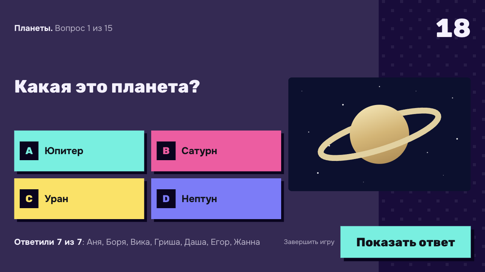
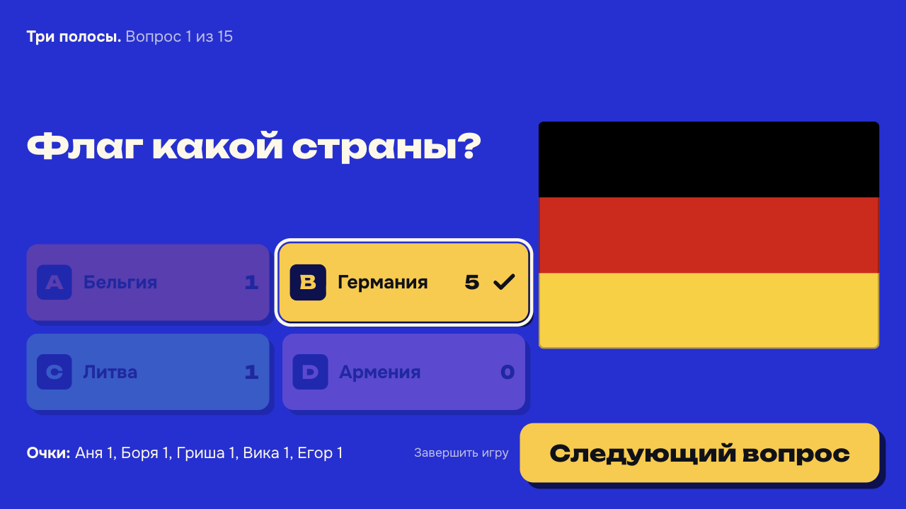
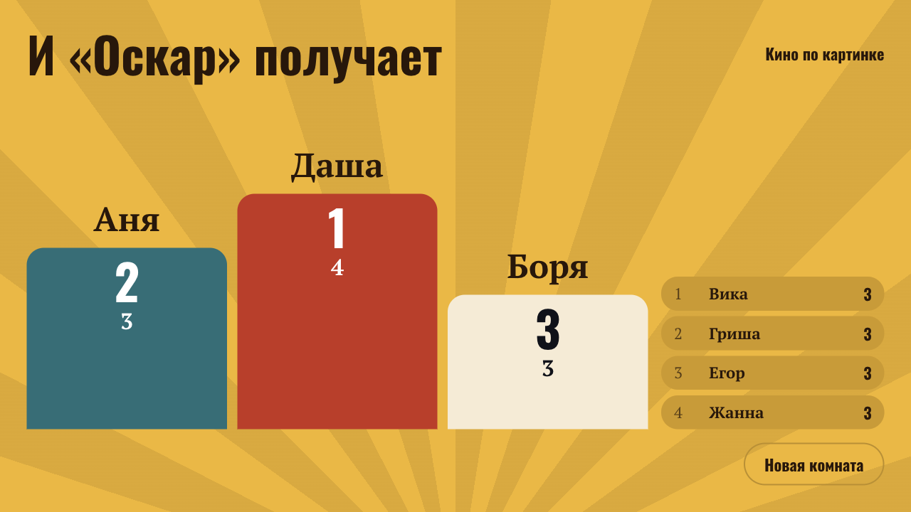
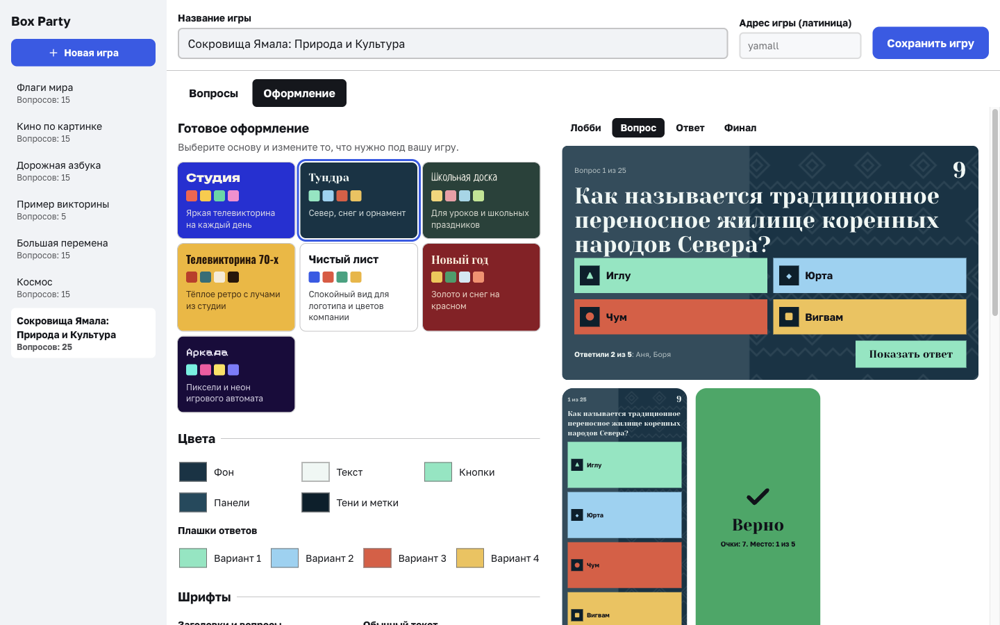
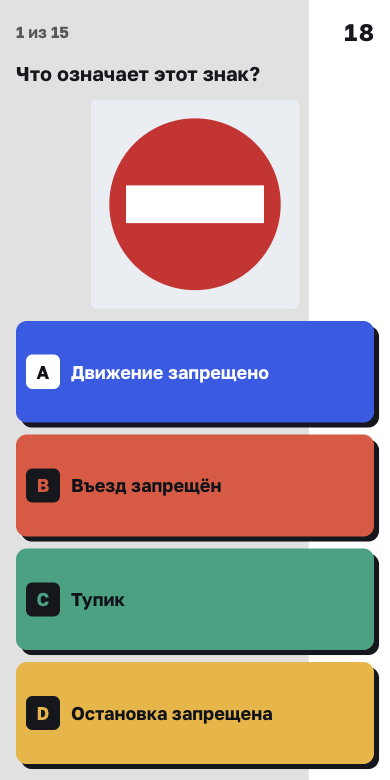
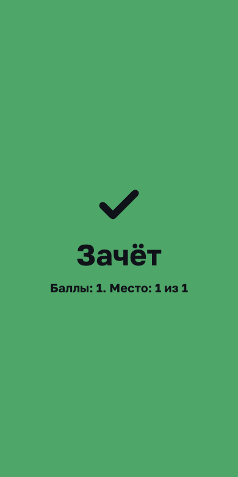

# Box Party

Викторина для компании: большой экран у ведущего, ответы на телефонах. Работает внутри вашей сети, без интернета, регистрации и подписки. Игрокам ничего не нужно устанавливать, достаточно отсканировать QR-код.



## Скачать

[Последняя версия на странице релизов](https://github.com/ognewmax-eng/Box/releases/latest)

| Система | Файл |
|---------|------|
| macOS, Apple Silicon (M1 и новее) | `Box-Party-<версия>-mac-arm64.dmg` |
| macOS, Intel | `Box-Party-<версия>-mac-intel.dmg` |
| Windows | `Box-Party-<версия>-windows-setup.exe` |

Установите приложение, создайте комнату и покажите QR-код игрокам. Телефоны должны быть в той же Wi-Fi сети, что и компьютер.

Приложение не подписано сертификатом разработчика, поэтому при первом запуске система покажет предупреждение. Что делать, описано в разделе [«Приложение»](#приложение-без-командной-строки).

## Что умеет

- **7 готовых игр:** флаги, космос, кино, школьная программа, дорожные знаки, Ямал и пробная викторина.
- **Своё оформление у каждой игры:** 7 готовых тем, цвета, шрифты, логотип, фон, свои слова на экранах. Результат виден сразу.
- **Свои вопросы:** выбор варианта или свой ответ, фото, видео и звук.
- **Правила на вашу игру:** время на ответ, запуск таймера ведущим, показ правильного ответа после каждого вопроса или только в конце.
- **Обрыв связи не портит игру:** игрок и ведущий возвращаются сами, очки сохраняются.

| Лобби | Показ ответа |
|---|---|
|  |  |
| **Финал** | **Настройка оформления** |
|  |  |

| Вопрос на телефоне | Результат на телефоне |
|---|---|
|  |  |

## Стек

- **Приложение:** Electron
- **Сервер:** Node.js, Express, Socket.io
- **Клиент:** React, Tailwind CSS, Framer Motion. Шрифты лежат в сборке, поэтому игра выглядит одинаково без интернета
- **Язык интерфейса:** русский

## Запуск

### Приложение (без командной строки)

Как установить:

- **macOS:** откройте файл DMG и перетащите Box Party в «Программы».
- **Windows:** запустите установщик.

Приложение само запускает сервер и открывает экран ведущего. Node.js не нужен, пароль для настройки игр вводить не нужно. Ссылка и QR-код для телефонов показаны в лобби. Если порт 3000 занят, приложение возьмёт другой.

Игры и загруженные файлы хранятся в папке пользователя, путь к ней есть в меню «Игра → Показать папку с играми». Готовые игры копируются туда при запуске и не перезаписывают ваши изменения.

Приложение не подписано сертификатом разработчика, поэтому при первом запуске система предупредит об этом:

- **macOS:** если появится окно с отказом, откройте «Системные настройки → Конфиденциальность и безопасность» и нажмите «Всё равно открыть». Разрешите доступ к локальной сети, иначе телефоны не подключатся.
- **Windows:** в окне SmartScreen нажмите «Подробнее → Выполнить в любом случае». Разрешите доступ в брандмауэре.

Собрать установщики самому (появятся в папке `release/`):

```bash
npm install && npm --prefix client install
npm run dist:mac
npm run dist:win
```

Запустить приложение из исходников: `npm run app`.

### Быстрый запуск из исходников (Windows и Mac)

Самый простой способ — скрипт **start**, который сам установит недостающие зависимости, соберёт клиент, если исходники изменились, запустит сервер и откроет браузер.

- **Windows:** дважды щёлкните по `start.bat` или в терминале: `node start.js`
- **macOS:** дважды щёлкните по `start.command` или в терминале: `node start.js`

Требуется [Node.js](https://nodejs.org/) 20.19 или новее. После запуска откроется главная страница; для ведущего перейдите на http://localhost:3000/host, для игроков — http://localhost:3000/client (с телефона подставьте ваш IP из консоли).

Остановка: закройте окно терминала или нажмите в нём Ctrl+C.

### Установка зависимостей

```bash
npm install
cd client && npm install && cd ..
```

### Режим разработки

Запустите сервер и клиент одновременно:

```bash
npm run dev
```

- Сервер: http://localhost:3000  
- Клиент (Vite): http://localhost:5173 (проксирует API и Socket.io на 3000)

Откройте в браузере:
- **Ведущий (ПК):** http://localhost:5173/host
- **Игрок (телефон):** с телефона в той же Wi‑Fi сети: http://**ВАШ_IP**:5173/client (или после сборки http://**ВАШ_IP**:3000/client)

### Продакшен (одна точка входа)

```bash
npm run build
npm run dev:server
```

После этого раздаётся только сервер на порту 3000. Открывайте:
- http://localhost:3000 (главная)
- http://localhost:3000/host
- http://localhost:3000/client
- http://localhost:3000/admin

**Для игры с телефонов:** замените `localhost` на локальный IP (например 192.168.1.x). IP выводится в консоли при старте сервера.

### Подключение с телефона

#### Подключение без туннеля (пошагово)

1. **Один раз настроить брандмауэр.** В папке проекта откройте папку `scripts` и **дважды щёлкните** по `add-firewall-rules.cmd` (появится запрос «Разрешить изменения» — нажмите «Да»). Либо откройте PowerShell **от имени администратора**, перейдите в папку проекта и выполните:
   ```powershell
   Set-ExecutionPolicy -Scope Process -ExecutionPolicy Bypass -Force; .\scripts\add-firewall-rules.ps1
   ```
2. **Сделать Wi‑Fi «частной» сетью.** Параметры → Сеть и Интернет → Wi‑Fi → ваша сеть → «Профиль сети» → **Частная**.
3. **Собрать и запустить сервер:** `npm run build` и `npm run dev:server`. В консоли будет строка **«С телефона: http://192.168.x.x:3000»**.
4. **Проверка с ПК.** На самом ПК в браузере откройте этот адрес, например `http://192.168.0.19:3000/api/health`. Должен открыться ответ с `"ok":true`. Если на ПК по этому адресу не открывается — сервер слушает не на том интерфейсе (напишите в issue).
5. **С телефона** откройте в браузере **http://ВАШ_IP:3000/client** (тот же IP, что в консоли). Телефон должен быть в той же Wi‑Fi сети, что и ПК.
6. Если по-прежнему таймаут — попробуйте **точку доступа с ПК**: Параметры → Сеть и Интернет → Точка доступа для мобильных устройств → включить. Подключите телефон к этой Wi‑Fi. На телефоне откройте **http://192.168.137.1:3000/client**.

#### Если страница не загружается — проверка по шагам:

1. **Проверка доступности сервера.** На телефоне в браузере откройте **http://ВАШ_IP:3000/api/health** (подставьте IP из консоли, например http://192.168.0.19:3000/api/health).
   - Если видите `{"ok":true,"message":"Сервер доступен",...}` — сервер досягаем, значит проблема была с загрузкой SPA; попробуйте снова открыть http://ВАШ_IP:3000/client или http://ВАШ_IP:3000/.
   - Если страница не открывается (таймаут, «нет соединения») — блокирует **брандмауэр** или сеть.

2. **Брандмауэр Windows.** Разрешите входящие подключения для Node:
   - Параметры → Сеть и Интернет → Брандмауэр Windows → Разрешить приложение через брандмауэр → Изменить параметры → найдите **Node.js JavaScript Runtime** и отметьте **Частные** (и при необходимости Общедоступные). Сохраните.
   - Или в PowerShell **от имени администратора** выполните (разрешить для **всех** профилей сети — и частная, и общедоступная):
     ```powershell
     New-NetFirewallRule -DisplayName "Node 3000" -Direction Inbound -Protocol TCP -LocalPort 3000 -Action Allow -Profile Any
     ```
     Если правило «Node 3000» уже есть, сначала удалите:  
     `Remove-NetFirewallRule -DisplayName "Node 3000"`  
     затем создайте снова с `-Profile Any`.

3. **Профиль сети в Windows.** Если Wi‑Fi помечен как «Общедоступная сеть», правило с профилем «Частная» не сработает. Либо создайте правило с **-Profile Any** (см. выше), либо сделайте сеть частной: Параметры → Сеть и Интернет → Wi‑Fi → имя сети → «Профиль сети» → выберите **Частная**.

4. **Роутер.** У некоторых роутеров включена «изоляция клиентов» (AP isolation). Два варианта обхода:
   - **Точка доступа с телефона:** телефон раздаёт Wi‑Fi, ПК подключается к нему. В консоли сервера смотрите «С телефона: http://192.168.x.x:3000» и на телефоне открывайте этот адрес.
   - **Точка доступа с ПК (часто надёжнее):** Параметры Windows → Сеть и Интернет → **Точка доступа для мобильных устройств** → включите, задайте имя и пароль. Подключите телефон к этой Wi‑Fi сети. Обычно IP ПК в такой сети — **192.168.137.1**. На телефоне откройте: `http://192.168.137.1:3000/client` и при необходимости `http://192.168.137.1:3000/api/health`.

5. **Разрешить Node по пути в брандмауэре.** Если порт открыт, но доступ всё равно блокируется, добавьте правило по программе (PowerShell от администратора):
   ```powershell
   $node = (Get-Command node).Source
   New-NetFirewallRule -DisplayName "Node.js Server" -Direction Inbound -Program $node -Action Allow -Profile Any
   ```

6. **Туннель — надёжный способ, если без туннеля таймаут.** Одна команда поднимает сервер и туннель:
   ```bash
   npm run tunnel
   ```
   В выводе найдите строку `your url is: https://xxxx.loca.lt`. **На ПК** откройте в браузере **https://xxxx.loca.lt/host** (экран ведущего). Создайте комнату — QR-код и ссылка в лобби будут вести на **https://xxxx.loca.lt/client?room=КОД**, так что игроки по скану QR или по ссылке попадут в игру через туннель. При первом заходе на *.loca.lt может появиться «Click to continue» — нажмите, затем откройте нужную страницу снова.

7. **Антивирус.** Касперский, Norton, Avast и др. часто имеют свой «сетевой экран». В настройках антивируса найдите раздел «Сеть» / «Firewall» и добавьте разрешение для Node.js или для порта 3000.

8. **Другой порт.** Если порт 3000 блокируется, попробуйте 8080 (в корне проекта в PowerShell: `$env:PORT=8080; npm run dev:server`). В консоли будет «С телефона: http://192.168.x.x:8080» — на телефоне откройте этот адрес.

## Пароль админки

Админка и чтение паков с ответами закрыты паролем. Он создаётся при первом запуске, показывается в окне сервера и хранится в файле `.admin-password` рядом с игрой. Свой пароль можно задать через переменную `ADMIN_PASSWORD`.

## Оформление игры

У каждого пака своё оформление: откройте `/admin`, выберите игру и перейдите на вкладку «Оформление». Там же видно, как экраны будут выглядеть на самом деле.

- **Готовые темы:** Студия, Тундра, Школьная доска, Телевикторина 70-х, Чистый лист, Новый год, Аркада.
- **Что настраивается:** цвета фона, текста, кнопок и плашек ответов, шрифты, форма углов и плашек, метки ответов (буквы, цифры, фигуры), узор, снег или мерцание, логотип, фоновая картинка, тексты («Верно», название очков, заголовок финала) и то, что показывать на экранах.
- **Читаемость:** если текст сливается с фоном, редактор предупредит об этом.

Когда ведущий выбирает игру в лобби, большой экран и телефоны игроков сразу перекрашиваются. В файле пака настройки лежат в поле `theme`, например `"theme": { "preset": "tundra", "texts": { "pointsLabel": "Олени" } }`.

## Если пропала связь

- **Игрок** возвращается автоматически, с очками и уже отправленным ответом. Сессия хранится в браузере телефона, поэтому можно обновить страницу или разблокировать экран.
- **Ведущий** возвращается так же: комната ждёт его 5 минут, а игроки видят предупреждение. Закончить игру раньше можно кнопкой «Завершить игру».
- Из лобби отключившийся игрок убирается через минуту, в идущей игре он остаётся до конца.

Новые игроки в идущую игру не допускаются.

## Тесты

```bash
npm test
```

Запускает тесты сервера (полный игровой цикл, возврат в игру, защита, API) и клиента.

## Роли

| Путь    | Назначение |
|--------|------------|
| `/`    | Главная, выбор роли |
| `/host`  | Экран ведущего: создание комнаты, лобби с QR, вопросы, результаты, таблица лидеров |
| `/client` | Экран игрока: ввод кода и ника, ответы A/B/C/D, результаты |
| `/admin`  | Создание и редактирование паков (вопросы и ответы в JSON) |

## Игровой цикл

1. **Ведущий** создаёт комнату → получает 4-буквенный код и ссылку для входа (можно показать QR).
2. **Игроки** заходят на `/client`, вводят код и ник, попадают в лобби.
3. Ведущий выбирает пак (или тест без пакa) и нажимает «Начать игру».
4. **Вопрос:** на ПК показывается вопрос и таймер; на телефонах — кнопки A, B, C, D. Ответы синхронизируются в реальном времени («Игрок X ответил»).
5. Ведущий нажимает «Показать ответ» (или ждёт таймер) → показываются правильный ответ и очки раунда.
6. «Следующий вопрос» — повтор до конца пака, затем итоговая таблица.

## Структура проекта

```
Box/
├── server.js           # Точка входа: пароль админки, запуск сервера
├── server/
│   ├── app.js          # Сборка Express и Socket.io, проверка Origin
│   ├── game.js         # Комнаты, игровой цикл, возврат в игру
│   ├── http.js         # API паков и загрузка медиа
│   ├── packs.js        # Чтение, проверка и сохранение паков
│   ├── theme.js        # Проверка настроек оформления
│   └── network.js      # IP компьютера и ссылка для QR-кода
├── constants.js        # Состояния игры и события сокетов (общие с клиентом)
├── games/              # JSON-паки викторин
│   ├── sample.json
│   └── media/          # медиа вопросов (фото, видео, аудио) по папкам паков
├── client/             # React (Vite)
│   ├── src/
│   │   ├── pages/      # Host, Client, Admin, Home
│   │   ├── views/      # Экраны ведущего и игрока (их же показывает превью)
│   │   ├── theme/      # Готовые темы, шрифты, расчёт цветов
│   │   ├── admin/      # Редакторы вопросов и оформления
│   │   ├── components/ # Плашки, код комнаты, таблица лидеров
│   │   └── hooks/      # Сокет и логика игры
│   └── ...
├── package.json
└── README.md
```

## Готовые игры

В поставке есть игры на разные случаи, у каждой своё оформление:

| Игра | Для кого | Вопросы |
|------|----------|---------|
| Флаги мира | Любая компания | 15, угадать страну по флагу |
| Космос | Семья, школа | 15, планеты, созвездия и история полётов |
| Кино по картинке | Вечеринка | 15, угадать фильм по рисунку и вопросы о советском кино |
| Большая перемена | Школьники примерно 8–11 лет | 15, часы, дроби, геометрия и окружающий мир |
| Дорожная азбука | Дети и взрослые | 15, знаки и светофор |
| Сокровища Ямала | Тематический вечер | 25 |
| Пример викторины | Проверка перед игрой | 5 |

Иллюстрации нарисованы для этих игр в формате SVG и лежат в `games/media/`, поэтому игры работают без интернета. Загрузка своих файлов через админку принимает фото, видео и звук, но не SVG.

## Формат пака (JSON)

В `games/*.json`:

```json
{
  "title": "Название пака",
  "questions": [
    {
      "question": "Текст вопроса?",
      "options": ["Вариант A", "Вариант B", "Вариант C", "Вариант D"],
      "correctIndex": 0
    }
  ]
}
```

`correctIndex` — индекс правильного варианта (0 = A, 1 = B и так далее, до 10 вариантов). Паки можно создавать и редактировать в админке `/admin`.

В вопросах можно указать медиа (опционально): **image**, **video**, **audio** — URL или путь к файлу (например после загрузки в админке путь вида `id-пака/имя-файла`). Файлы загружаются в `games/media/<id-пака>/` и отдаются по адресу `/media/...`.

В настройках игры, на вкладке «Вопросы», можно выключить показ правильного ответа после каждого вопроса (`"theme": { "options": { "showAnswers": false } }`). Тогда до конца раунда игроки не видят ни ответа, ни счёта, а ведущий открывает все ответы на финальном экране.

В открытых вопросах регистр, ё/е, знаки препинания и лишние пробелы не важны. У раунда можно указать название (`roundTitle`).

У каждого **раунда** можно задать **режим таймера**: `timerStart: "auto"` — таймер стартует сразу при показе вопроса; `timerStart: "manual"` — таймер запускает ведущий кнопкой «Старт таймера».
